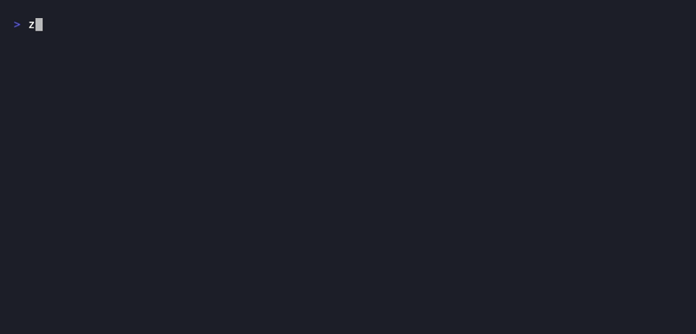

**English** | [简体中文](README.md)

<picture>
  <source media="(max-width: 640px) and (prefers-color-scheme: dark)" srcset="assets/presentation/hero-mobile-dark.svg">
  <source media="(max-width: 640px)" srcset="assets/presentation/hero-mobile-light.svg">
  <source media="(prefers-color-scheme: dark)" srcset="assets/presentation/hero-dark.svg">
  
</picture>

**Convert headings, narration and quotes into audio, subtitles and scene cards, producing MP4, cover and SRT files.**

`v0.4.0` · `Python 3.12+ / ffmpeg` · [MIT](LICENSE)

[Website](https://zhicast.lei6393.com) · [Demo record](docs/demo-results.json)

## Why use it

Video drafts repeat the work of arranging title cards, quote cards and subtitles. ZhiCast uses a small Markdown convention to connect parsing, audio timing, subtitles and frames. Authors remain responsible for checking content, pronunciation, pacing and the actual published presentation.

## Architecture

<picture>
  <source media="(max-width: 640px) and (prefers-color-scheme: dark)" srcset="assets/presentation/architecture-mobile-dark.svg">
  <source media="(max-width: 640px)" srcset="assets/presentation/architecture-mobile-light.svg">
  <source media="(prefers-color-scheme: dark)" srcset="assets/presentation/architecture-dark.svg">
  
</picture>

parse builds ZhiScript; tts fills segment timing and audio; subtitle creates SRT cues; overlay draws cards, subtitles and covers with Pillow; render calls ffmpeg to compose video. CLI and local Web share this pipeline. Subtitles are drawn into PNG scenes before encoding, without libass.

Source entry points: [zhicast/cli.py](zhicast/cli.py) · [zhicast/parse.py](zhicast/parse.py) · [zhicast/tts.py](zhicast/tts.py) · [zhicast/model.py](zhicast/model.py) · [zhicast/subtitle.py](zhicast/subtitle.py) · [zhicast/overlay.py](zhicast/overlay.py) · [zhicast/render.py](zhicast/render.py) · [zhicast/web.py](zhicast/web.py)

## Install

Requires Python 3.12+, uv, ffmpeg/ffprobe, libx264/AAC encoders and a CJK font. On macOS use brew install ffmpeg; on Debian/Ubuntu install ffmpeg and fonts-noto-cjk. The python-multipart dependency used by web forms ships with the package, so `serve` works out of the box.

```bash
git clone https://github.com/SuperMarioYL/zhicast.git
cd zhicast
uv venv --python 3.12
uv pip install --python .venv/bin/python -e .
```

## Quickstart

The example runs parsing, silent audio, subtitles, Pillow scenes and ffmpeg encoding, then reads video dimensions and frame rate with ffprobe. It uses no real speech, upload or platform validation; temporary media is removed after inspection.

```bash
.venv/bin/python examples/presentation-demo.py
```

Complete inputs and execution steps are included in the commands above and the [demo record](docs/demo-results.json).

## Usage

```bash
.venv/bin/zhicast build examples/presentation-script.md -o out/ --tts-provider stub
.venv/bin/zhicast serve --port 8000 --tts-provider stub
```
For real speech, change build’s --tts-provider to edge and choose an available --voice. `# Title` sets the cover, `## Section` creates a title segment, `> Quote (source)` creates a quote card (consecutive quote lines merge into one card) and paragraphs become narration. build retains out/video.mp4, cover.png, video.srt and manifest.json.

## Recorded demo

<picture>
  <source media="(max-width: 640px) and (prefers-color-scheme: dark)" srcset="assets/presentation/process-mobile-dark.svg">
  <source media="(max-width: 640px)" srcset="assets/presentation/process-mobile-light.svg">
  <source media="(prefers-color-scheme: dark)" srcset="assets/presentation/process-dark.svg">
  
</picture>

### Render and inspect video

Produces 3 segments, 3 subtitle cues, 5 scene images and a 1920×1080, 30fps H.264 video.

```text
$ .venv/bin/python examples/presentation-demo.py
{
  "tts_provider": "stub (silent audio)",
  "segments": 3,
  "subtitle_cues": 3,
  "scene_images": 5,
  "cover_exists": true,
  "srt_exists": true,
  "video_stream": {
    "codec_name": "h264",
    "width": 1920,
    "height": 1080,
    "r_frame_rate": "30/1"
  }
}
```

## Capabilities and integration

<picture>
  <source media="(max-width: 640px) and (prefers-color-scheme: dark)" srcset="assets/presentation/integrations-mobile-dark.svg">
  <source media="(max-width: 640px)" srcset="assets/presentation/integrations-mobile-light.svg">
  <source media="(prefers-color-scheme: dark)" srcset="assets/presentation/integrations-dark.svg">
  
</picture>

The local CLI generates an output directory; the Web UI accepts pasted scripts and offers downloads. edge is an implemented network TTS path and stub generates silence. doubao and qwen are selectable names but currently raise not-implemented errors.


## Configuration

The default edge voice is zh-CN-XiaoxiaoNeural and --out selects the directory. RenderSpec defaults to 1920×1080, 30fps, CRF 23, libx264, yuv420p and AAC. Subtitle policy uses 28 display-width units per line and up to two lines; this is a project layout convention, not platform certification. If word timing is unavailable, edge timing is distributed across sentence windows and needs review.

## Roadmap and scope

Section/quote cards, covers, local Web and offline rendering are implemented. Doubao/Qwen TTS, template editing, batch series and cloud rendering remain future work.

- stub produces silence and synthetic timestamps; it cannot establish real speech or subtitle-alignment quality.
- Review long sentences, font coverage and subtitle grouping manually. No Bilibili upload or distribution-effect validation was performed.

 · [Recording script](docs/demo.tape)

## License

[MIT](LICENSE)
