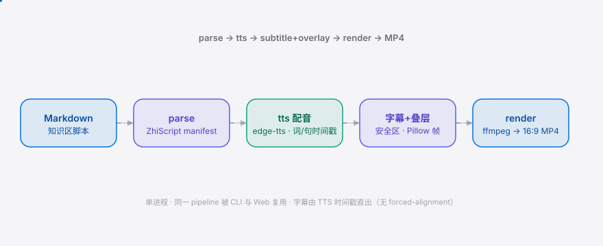

<div align="right"><sub><a href="./README.en.md">English</a>&nbsp;&nbsp;⇄&nbsp;&nbsp;<b>简体中文</b></sub></div>

<picture>
  <source media="(prefers-color-scheme: dark)" srcset="./assets/hero-dark.svg">
  <source media="(prefers-color-scheme: light)" srcset="./assets/hero-light.svg">
  
</picture>

<p align="center"><sub>ZhiCast 是把 agent 驱动的 script-to-video 能力接到 B站知识区 16:9 横屏格式的开源工具。</sub></p>

<p align="center">
  <a href="./LICENSE"></a>
  <a href="https://github.com/SuperMarioYL/zhicast/releases"></a>
  <a href="https://github.com/SuperMarioYL/zhicast/actions/workflows/ci.yml"></a>
  
  
  
</p>

**贴一段 markdown 脚本，一键拿到带 TTS 配音、烧录字幕与引用标注的 B站知识区 16:9 视频——不用时间线、不用 coding agent。**

---

## 为什么是现在

ZhiCast 把 **agent** 驱动的 script-to-video 能力接到 B站知识区 16:9 横屏格式。这套能力已被 [OpenMontage](https://github.com/calesthio/OpenMontage)（45K★，“agentic video production system”）与 [hyperframes](https://github.com/heygen-com/hyperframes)（39K★，“Write HTML. Render video. Built for agents”）验证可行——但它们都锁在 coding agent 之后，产出的是通用视频，没有编码 B站知识区格式规则（字幕安全区、引用标注、弹幕节奏、开场→论证→总结）。

本产品复用通用 Agent 平台 [langgenius/dify](https://github.com/langgenius/dify) 的 agent 化思路，落到知识区格式面：贴 markdown 脚本 → edge-tts 配音 + 烧录字幕（由 TTS 时间戳直出，无 forced-alignment）+ 引用标注卡片 → 16:9 MP4 + 封面。非技术 UP主在浏览器贴脚本即可出片，无需 Python 或 coding agent。

<h2> 架构</h2>

<picture>
  <source media="(prefers-color-scheme: dark)" srcset="./assets/atlas-dark.svg">
  <source media="(prefers-color-scheme: light)" srcset="./assets/atlas-light.svg">
  
</picture>

单进程 Python，无微服务。CLI 与 Web 复用同一条 `parse → tts → subtitle → overlay → render` 链路。字幕安全区与引用/章节叠层由 Pillow 渲染成 PNG 帧再用 ffmpeg 拼接，因此即便 ffmpeg 是不含 libass 的最小构建也能跑通。

<h2> 安装</h2>

需要 Python 3.12+ 与 ffmpeg（含 `overlay` 滤镜即可；字幕已烧进 PNG 帧，不依赖 libass）。

```bash
# macOS
brew install ffmpeg
# Debian/Ubuntu
sudo apt install ffmpeg

pip install zhicast
```

<h2> 快速开始</h2>

```bash
git clone https://github.com/SuperMarioYL/zhicast.git && cd zhicast
pip install -e ".[dev]"
zhicast build examples/sample_script.md -o out/ --tts-provider stub
```

`--tts-provider stub` 用离线静音引擎，不联网即可跑通整条流水线。换成默认的 `edge`（需联网）即得到真实 TTS 配音。

<details><summary>示例输出</summary>

```
[1/6] parse script: examples/sample_script.md
      title='为什么大模型记不住你三句话前说过的话' segments=9
[2/6] tts (stub, voice=zh-CN-XiaoxiaoNeural)
      total=18.4s
[3/6] subtitle plan (字幕安全区)
      cues=9 srt=video.srt
[4/6] overlay scenes + cover
      scenes=18 cover=cover.png
[5/6] render video (ffmpeg)
      mp4=video.mp4
[6/6] done
output: out/video.mp4
```
</details>

<h2> 用法</h2>

CLI 一键出片（默认 edge-tts，真实配音）：

```bash
zhicast build script.md -o out/
```

换音色或离线预览：

```bash
zhicast build script.md -o out/ --tts-provider edge --voice zh-CN-YunxiNeural
zhicast build script.md -o out/ --tts-provider stub          # 离线、不联网
```

本地 Web 页（贴脚本 → 生成 → 下载 MP4 + 封面 + SRT）：

```bash
zhicast serve --port 8000          # http://127.0.0.1:8000
```

脚本约定：`# 标题` → 封面标题；`## 章节` → 章节标题卡；`> 引用 (来源)` → 引用标注卡；普通段落 → TTS 旁白。详见 [`examples/sample_script.md`](./examples/sample_script.md)。

<h2> Demo</h2>


从 markdown 脚本到 16:9 知识区视频的完整路径：贴脚本 → TTS 配音 + 字幕安全区烧录 + 引用标注卡片浮现 → 输出 MP4 与封面。重渲染见 [`docs/demo.tape`](./docs/demo.tape) 与 [demo workflow](./.github/workflows/demo.yml)。

<h2> 配置</h2>

| 选项 | 默认 | 说明 |
|---|---|---|
| `--tts-provider` | `edge` | TTS 引擎：`edge`（联网、默认）/ `stub`（离线静音）/ `doubao` / `qwen`（v0.2+，国产默认） |
| `--voice` | `zh-CN-XiaoxiaoNeural` | edge-tts 音色 id（如 `zh-CN-YunxiNeural` 男声） |
| `--out` | `out/` | 输出目录（含 `video.mp4` / `cover.png` / `video.srt` / `manifest.json`） |
| 字幕安全区 | 1920×1080 底部 | ≤14 CJK 字/行、≤2 行、底部安全区、弹幕节奏间隙 |
| 渲染参数 | 30fps · crf 23 · yuv420p · aac 192k | 见 `RenderSpec`（`zhicast/model.py`） |

<h2> 路线图</h2>

- [x] **m1 出片流水线** — markdown → edge-tts（句级时间戳）→ 字幕安全区 SRT → Pillow 帧 + 封面 → ffmpeg → 16:9 MP4，CLI `zhicast build` 端到端跑通
- [ ] **m2 知识区格式面** — 引用标注卡片 + 章节标题卡 + 封面模板 + 本地 Web 页（贴脚本→生成→下载），可演示的 MVP
- [ ] **m3 launch readiness** — 30s demo GIF + 豆包 TTS provider（国产默认）+ Gitee 镜像，Show HN / V2EX 就绪
- [ ] **v0.2 托管云渲染层** — 零安装、豆包高质量音色、封面模板、批量系列渲染

<h2> 付费 / Pricing</h2>

本地引擎完全开源、免费、可商用——但你得自己装 Python 和 ffmpeg。多数非技术 UP主不会装。

**托管云渲染层（v0.2，付费）** 解决这点：浏览器贴脚本 → 云端渲染（内置 ffmpeg + 豆包高质量音色 + 精选封面模板 + 批量系列）→ 下载成片，零本地安装。定价 **¥29/月**（约 10 期/月）或按条 **¥1–2/期** 的 credit pack。这是面向小工作室 UP主团队（每周多期 5–15 分钟）的“刷信用卡”路径——他们出片量大、3–6 小时/期的剪辑成本是真痛点。本地 OSS 引擎先上线验证需求；第一个付费客户触发 v0.1 → v0.2 升级。

<h2> 对比</h2>

与通用 Agent 平台 [langgenius/dify](https://github.com/langgenius/dify) 的定位差异：

| 维度 | ZhiCast | dify（通用 Agent 平台） |
|---|---|---|
| 目标用户 | B站知识区 UP主（非技术） | 开发者 / 工程团队 |
| 输入 | markdown 脚本直贴 | API / workflow 编排 |
| 输出 | 16:9 知识区 MP4 + 封面 + SRT | 通用 agent 应用 |
| TTS 时间戳→字幕 | ✓（edge-tts 句级直出，无 forced-alignment） | — |
| 知识区格式规则 | ✓（字幕安全区 / 引用标注 / 弹幕节奏） | — |
| 生态与可扩展性 | ✗（单一用途） | ✓（丰富 agent 生态、插件） |

dify 在生态广度上远胜 ZhiCast——它是通用 agent 平台，ZhiCast 是单一用途的垂直出片工具；ZhiCast 不与它正面竞争，而是把它代表的 agent 化思路落到 B站知识区格式这个它结构上不会覆盖的面。

<h2> 分享</h2>

```
ZhiCast —— 给 B站知识区 UP主 的 script-to-video 工具。Agent 时代的脚本直出视频：贴 markdown → TTS 配音 + 烧录字幕 + 引用标注 → 16:9 MP4。不用 coding agent。https://github.com/SuperMarioYL/zhicast
```

<h2> License</h2>

MIT，见 [LICENSE](./LICENSE)。提 issue 或 PR 请到 [issues](https://github.com/SuperMarioYL/zhicast/issues)。

<p align="center"><sub><a href="./LICENSE">MIT</a> © 2026 SuperMarioYL</sub></p>
