[English](README.en.md) | **简体中文**

<picture>
  <source media="(max-width: 640px) and (prefers-color-scheme: dark)" srcset="assets/presentation/hero-mobile-dark.svg">
  <source media="(max-width: 640px)" srcset="assets/presentation/hero-mobile-light.svg">
  <source media="(prefers-color-scheme: dark)" srcset="assets/presentation/hero-dark.svg">
  
</picture>

**将标题、正文和引用转换成配音、字幕与卡片画面，输出 MP4、封面和 SRT。**

`v0.4.0` · `Python 3.12+ / ffmpeg` · [MIT](LICENSE)

[Website](https://zhicast.lei6393.com) · [Demo record](docs/demo-results.json)

## 为什么使用

为讲解稿制作初稿时，标题卡、引用卡和字幕重复排版会占用不少时间。ZhiCast 约定一小套 Markdown 结构，把脚本解析、音频时序、字幕与画面串起来。作者仍负责检查内容、发音、节奏和发布后的实际呈现。

## 架构

<picture>
  <source media="(max-width: 640px) and (prefers-color-scheme: dark)" srcset="assets/presentation/architecture-mobile-dark.svg">
  <source media="(max-width: 640px)" srcset="assets/presentation/architecture-mobile-light.svg">
  <source media="(prefers-color-scheme: dark)" srcset="assets/presentation/architecture-dark.svg">
  
</picture>

parse 构建 ZhiScript，tts 填写片段时间与音频，subtitle 生成 SRT cue，overlay 用 Pillow 画卡片、字幕与封面，render 调用 ffmpeg 合成视频。CLI 与本地 Web 使用同一条处理路径，字幕绘制进 PNG 场景后编码，无需 libass。

源码入口：[zhicast/cli.py](zhicast/cli.py) · [zhicast/parse.py](zhicast/parse.py) · [zhicast/tts.py](zhicast/tts.py) · [zhicast/model.py](zhicast/model.py) · [zhicast/subtitle.py](zhicast/subtitle.py) · [zhicast/overlay.py](zhicast/overlay.py) · [zhicast/render.py](zhicast/render.py) · [zhicast/web.py](zhicast/web.py)

## 安装

需要 Python 3.12+、uv、ffmpeg/ffprobe、可用的 libx264/AAC 编码器和中文字体。macOS 可运行 brew install ffmpeg；Debian/Ubuntu 可安装 ffmpeg 与 fonts-noto-cjk。Web 表单依赖的 python-multipart 已随包声明，安装后 `serve` 开箱即用。

```bash
git clone https://github.com/SuperMarioYL/zhicast.git
cd zhicast
uv venv --python 3.12
uv pip install --python .venv/bin/python -e .
```

## 快速开始

示例跑完整解析、静音音频、字幕、Pillow 场景与 ffmpeg 编码，并通过 ffprobe 读取视频尺寸和帧率。没有真实配音、上传或平台验收；临时成片在检查后清理。

```bash
.venv/bin/python examples/presentation-demo.py
```

完整输入与执行步骤见上方命令及 [Demo 记录](docs/demo-results.json)。

## 使用

```bash
.venv/bin/zhicast build examples/presentation-script.md -o out/ --tts-provider stub
.venv/bin/zhicast serve --port 8000 --tts-provider stub
```
要生成真实配音，将 build 的 --tts-provider 改为 edge，并选择实际可用的 --voice。`# 标题` 用于封面，`## 章节` 生成标题片段，`> 引用 (来源)` 生成引用卡（连续多行引用合并为同一张卡），普通段落作为旁白。上面的 build 会保留 out/video.mp4、cover.png、video.srt 与 manifest.json。

## 实际 Demo

<picture>
  <source media="(max-width: 640px) and (prefers-color-scheme: dark)" srcset="assets/presentation/process-mobile-dark.svg">
  <source media="(max-width: 640px)" srcset="assets/presentation/process-mobile-light.svg">
  <source media="(prefers-color-scheme: dark)" srcset="assets/presentation/process-dark.svg">
  
</picture>

### 生成并检查视频

得到 3 段、3 条字幕、5 张场景图以及 1920×1080、30fps 的 H.264 视频。

```text
$ .venv/bin/python examples/presentation-demo.py
{
  "tts_provider": "stub (silent audio)",
  "segments": 3,
  "subtitle_cues": 3,
  "scene_images": 5,
  "cover_exists": true,
  "srt_exists": true,
  "video_stream": {
    "codec_name": "h264",
    "width": 1920,
    "height": 1080,
    "r_frame_rate": "30/1"
  }
}
```

## 能力与接入

<picture>
  <source media="(max-width: 640px) and (prefers-color-scheme: dark)" srcset="assets/presentation/integrations-mobile-dark.svg">
  <source media="(max-width: 640px)" srcset="assets/presentation/integrations-mobile-light.svg">
  <source media="(prefers-color-scheme: dark)" srcset="assets/presentation/integrations-dark.svg">
  
</picture>

本地 CLI 可生成输出目录，Web 可粘贴脚本并下载结果。edge 是已实现的网络 TTS 路径；stub 生成静音。doubao 和 qwen 虽可通过参数选择，当前会明确报未实现。


## 配置

默认 edge 音色为 zh-CN-XiaoxiaoNeural；--out 控制目录。RenderSpec 默认 1920×1080、30fps、CRF 23、libx264、yuv420p 与 AAC。字幕策略使用 28 个显示宽度单位/行、最多两行；它是项目排版约定，不是平台认证。edge 缺少词级时序时会在句级窗口内均匀分配，时序需人工回看。

## 路线图与范围

当前提供章节/引用卡、封面、本地 Web 和离线渲染。豆包/Qwen TTS、模板编辑、批量系列与云渲染尚需后续实现。

- stub 输出静音并使用合成时间戳，不能据此评价真实配音或字幕对齐质量。
- 长句、字体覆盖和字幕分组需人工检查；没有执行 B站上传或推荐效果验证。

 · [Recording script](docs/demo.tape)

## 许可证

[MIT](LICENSE)
